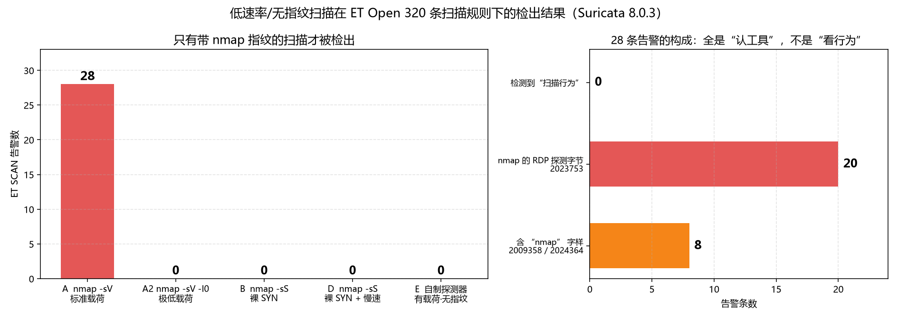

# slowscan-lab

**低速率 / 无指纹扫描对开源 IDS 规则集的规避效果量化**

基于 Suricata 8.0.3 + ET Open（320 条 `ET SCAN` 规则）的实证研究。

---

## 一句话结论

> **检测的鲁棒性由「范式 + 参数」决定，不由「规则数量」决定。**
> 320 条签名规则在“零指纹扫描”面前等于 0；1 个行为特征在“慢扫”面前也等于 0。

---

## 结果

**三种检测方式 × 七个条件的检出矩阵：**

| 检测方式 | A 带指纹 | A2 极低载荷 | B 裸 SYN 快 | D 裸 SYN 慢 | E 自制探测器 | F 自制+慢 | normal |
|---|---|---|---|---|---|---|---|
| **ET Open（签名）** | 28 条 | 0 | 0 | 0 | 0 | **0** | 0 |
| **行为检测（60 s 窗）** | ✅ | ✅ | ✅ | ❌ 漏 | ✅ | ❌ 漏 | ✅ 不误报 |
| **行为检测（300 s 窗）** | ✅ | ✅ | ✅ | ✅ | ✅ | ✅ | ✅ 不误报 |

**两个盲区不重叠，可被同时利用：**

- 签名检测的盲区 = **没有工具指纹**（条件 B / E / F）
- 行为检测（60 s）的盲区 = **比窗口更慢**（条件 D / F）
- **F（无指纹 + 慢扫）同时躲过两者** ← 核心发现

28 条告警的成分：**8 条匹配字符串 "nmap"，20 条匹配 nmap 的 RDP 探测字节，0 条检测到扫描行为。**



完整分析见 [RESULTS.md](RESULTS.md)。

---

## 快速开始

```bash
# 1. 依赖
sudo apt install -y suricata tcpdump nmap python3
sudo suricata-update

# 2. 放宽地址变量（否则 127.0.0.1 的流量不匹配任何扫描规则）
sudo cp /etc/suricata/suricata.yaml /etc/suricata/suricata.yaml.orig
sudo sed -i 's|^\( *\)HOME_NET:.*|\1HOME_NET: "any"|' /etc/suricata/suricata.yaml
sudo sed -i 's|^\( *\)EXTERNAL_NET:.*|\1EXTERNAL_NET: "any"|' /etc/suricata/suricata.yaml

# 3. 跑实验（每组都会自动起假服务、验证端口、抓包、分析）
sudo bash run.sh        # A / B / D
sudo bash run_a2.sh     # A2
sudo bash run_probe.sh  # E

# 4. 出图
pip install matplotlib
python3 plot_results.py
```

---

## 文件说明

| 文件 | 作用 |
|---|---|
| `fake_services.py` | 在 8001-8010 开 10 个假服务，回固定 HTTP 横幅 |
| `run.sh` | 条件 A / B / D |
| `run_a2.sh` | 条件 A2（极低载荷） |
| `run_probe.sh` | 条件 E（自制探测器） |
| `probe_like_a_scanner.py` | 无 nmap 指纹的"扫描器" |
| `rescan.sh` | 修正配置后重新分析已有 pcap |
| `plot_results.py` | 生成结果图 |
| `RESULTS.md` | 完整实验报告 |

---

## 环境

- Ubuntu 26.04（VMware，4 vCPU / 8 GB）
- Suricata 8.0.3，ET Open 规则集
- nmap 7.98
- 单机回环 `127.0.0.1`

---

## 局限

1. 单机回环环境，无真实网络噪声
2. 只测 ET Open，未覆盖商业规则与其他 IDS
3. 靶机服务为伪造，对所有协议返回同一横幅
4. 未测误报率

这些局限本身就是下一步工作：**在真实网段复现，并引入正常流量评估误报。**
